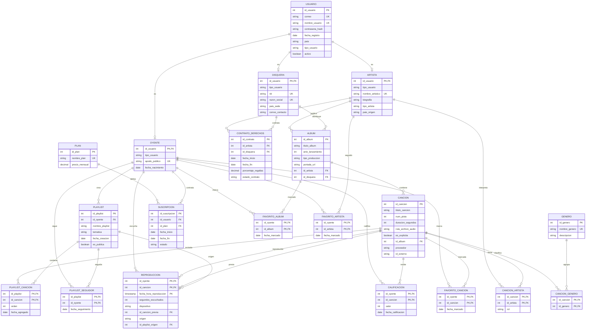

# Hell Music — Modelo Entidad-Relación

**Proyecto:** Hell Music (reproductor de música tipo Spotify)
**Curso:** Bases de Datos — Universidad Nacional de Colombia, 2026-II
**Alcance:** modelo relacional corregido a partir de las fichas F1–F12
**Motor objetivo:** MySQL 8.0+ / MariaDB 10.5+ (SQL estándar, sin PostgreSQL)

> El diagrama está en sintaxis Mermaid. Se renderiza directamente en GitHub,
> GitLab, VS Code (extensión Mermaid) o en <https://mermaid.live>. Si el entorno
> no renderiza Mermaid, al final del documento está el resumen textual de
> entidades y relaciones.

---

## 1. Diagrama ER

**Convenciones del diagrama**

- `PK` = clave primaria, `FK` = clave foránea, `UK` = clave única.
- `||--o{` = uno a cero o muchos; `||--o|` = uno a cero o uno.
- Las entidades débiles o históricas (`REPRODUCCION`, `CONTRATO_DERECHOS`,
  `SUSCRIPCION`) usan claves naturales o compuestas, no un `id` artificial.
- `REPRODUCCION` tiene dos relaciones con `CANCION`: la canción reproducida y
  la canción previa (`id_cancion_previa`), necesarias para RF-6/RF-7.

---

## 2. Resumen textual de entidades

| # | Tabla | Propósito | Clave primaria |
|---|-------|-----------|----------------|
| 1 | `plan` | Catálogo de planes (GRATUITO, PREMIUM) | `id_plan` |
| 2 | `genero` | Catálogo de géneros musicales | `id_genero` |
| 3 | `usuario` | Superclase con credenciales y datos comunes | `id_usuario` |
| 4 | `oyente` | Subclase: usuario que escucha y crea playlists | `id_usuario` |
| 5 | `artista` | Subclase: usuario que publica música | `id_usuario` |
| 6 | `disquera` | Subclase: usuario que representa artistas | `id_usuario` |
| 7 | `contrato_derechos` | Historial de contratos artista–disquera | `id_contrato` |
| 8 | `album` | Agrupación de canciones de un artista | `id_album` |
| 9 | `cancion` | Metadatos y ruta/URL del audio | `id_cancion` |
| 10 | `cancion_artista` | M:N canción–artista (principal/featuring) | `(id_cancion, id_artista)` |
| 11 | `cancion_genero` | M:N canción–género | `(id_cancion, id_genero)` |
| 12 | `playlist` | Lista creada por un oyente | `id_playlist` |
| 13 | `playlist_cancion` | M:N playlist–canción con orden | `(id_playlist, id_cancion)` |
| 14 | `playlist_seguidor` | M:N playlist–oyente (seguidores) | `(id_playlist, id_oyente)` |
| 15 | `suscripcion` | Historial de planes contratados | `id_suscripcion` |
| 16 | `calificacion` | Calificación 1–5 de un oyente a una canción | `(id_oyente, id_cancion)` |
| 17 | `favorito_cancion` | Canciones favoritas | `(id_oyente, id_cancion)` |
| 18 | `favorito_album` | Álbumes favoritos | `(id_oyente, id_album)` |
| 19 | `favorito_artista` | Artistas seguidos | `(id_oyente, id_artista)` |
| 20 | `reproduccion` | Historial de escucha con origen y canción previa | `(id_oyente, id_cancion, fecha_hora_reproduccion)` |

---

## 3. Decisiones de modelado

### 3.1. Jerarquía USUARIO → OYENTE / ARTISTA / DISQUERA

Las fichas F1 y F6 describen tres perfiles que se autentican, pero el modelo
original no tenía una superclase común. Se resolvió con:

- `usuario` concentra credenciales (`correo`, `nombre_usuario`,
  `contrasena_hash`), país, fecha de registro, estado y `tipo_usuario`.
- Cada subclase comparte la PK con `usuario` (`id_usuario`) y agrega
  `tipo_usuario` con `DEFAULT` y `CHECK` del valor permitido.
- La FK es **compuesta**: `(id_usuario, tipo_usuario)` referencia
  `usuario(id_usuario, tipo_usuario)`.

Esto impide, sin triggers, que un usuario sea oyente y artista a la vez: la FK
solo encuentra al padre si el tipo coincide. Además, cambiar el tipo de un
usuario con subclase existente viola la FK (RESTRICT), lo que protege la
consistencia histórica.

### 3.2. Contratos como historial, no como proceso operativo

F6 excluye la administración de contratos, pero F9 define `CONTRATO_DERECHOS`.
Se conservó como **tabla histórica** de solo consulta: registra vínculos
pasados y vigentes, con `fecha_inicio`, `fecha_fin`, regalías y estado. La
gestión operativa (altas, renovaciones, liquidación) queda fuera de alcance.
Esto satisface la trazabilidad sin contradecir el alcance de F6.

### 3.3. Premium con PLAN + SUSCRIPCION

La palabra "premium" aparecía en F10 sin tabla. Se agregó:

- `plan` con dos filas: `GRATUITO` (precio 0) y `PREMIUM`.
- `suscripcion` como historial por usuario, con estado
  (`ACTIVA`, `CANCELADA`, `VENCIDA`), fechas y FK a `plan`.

El plan actual de un usuario se deriva de su suscripción `ACTIVA`; no se
duplica en `usuario`. Esto evita una dependencia transitiva y permite analizar
cambios de plan en el tiempo.

### 3.4. REPRODUCCION con clave natural compuesta

La ficha RN-05 exige que una reproducción se identifique por oyente, canción e
instante. Se usó `PRIMARY KEY (id_oyente, id_cancion,
fecha_hora_reproduccion)` en lugar de un `id_reproduccion` artificial:

- Evita duplicados exactos del mismo evento.
- Permite que un usuario reproduzca la misma canción muchas veces en fechas
  distintas.
- Facilita las consultas de "últimos 30 días" y "mes anterior vs mes actual".

Se agregó `origen` (`PLAYLIST`, `RECOMENDACION`, `BUSQUEDA`, `ALBUM`, `OTRO`) e
`id_playlist_origen` para responder F10-Q3. Un `CHECK` exige que
`id_playlist_origen` exista si y solo si `origen = 'PLAYLIST'`.

### 3.5. Favoritos en tres tablas, no en una tabla genérica

F6 pide favoritos, pero no especifica si son canciones, álbumes o artistas.
Se modelaron tres tablas (`favorito_cancion`, `favorito_album`,
`favorito_artista`) en lugar de una tabla polimórfica:

- Cada FK queda tipada y validada por el motor.
- Las consultas son más simples y usan índices naturales.
- Se evita una columna `tipo_favorito` + `id_referencia` sin integridad
  referencial real.

El costo es tres tablas pequeñas; el beneficio es integridad y claridad.

### 3.6. Canciones, artistas y géneros como M:N

- `cancion_artista` resuelve RF-3 (colaboraciones) con `rol`
  (`PRINCIPAL`, `FEATURING`). La PK compuesta impide duplicar la misma
  colaboración.
- `cancion_genero` permite que una canción tenga varios géneros (fusión,
  crossovers) sin columnas repetidas.
- `playlist_cancion` usa PK `(id_playlist, id_cancion)` para RN-04 (sin
  canciones repetidas) y `UNIQUE (id_playlist, orden)` para que el orden sea
  consistente.

### 3.7. RN-01 sin audio binario

`cancion` guarda `ruta_archivo_audio` (URL o ruta), nunca el archivo. La pareja
`(proveedor, id_externo)` es `UNIQUE`, lo que evita duplicar una canción
importada de Jamendo/Audius. `proveedor` e `id_externo` van juntos o ambos son
NULL (`CHECK`).

### 3.8. Reglas cruzadas que no son CHECK

Algunas reglas involucran varias filas y no se pueden expresar con `CHECK`:

| Regla | ¿Dónde se valida? |
|-------|-------------------|
| Un solo plan ACTIVO por usuario | Consulta A05 de `06_tests.sql` + lógica de aplicación |
| Artista VINCULADO con contrato vigente | Consultas A06/A07 + lógica de aplicación |
| No seguir la propia playlist | Consulta A08 + lógica de aplicación |
| Origen PLAYLIST debe contener la canción | Consulta A09 + lógica de aplicación |
| Segundos escuchados ≤ duración | Consulta A10 + lógica de aplicación |
| Artista principal = dueño del álbum | Consulta A11 + lógica de aplicación |

Estas reglas se documentan y se prueban; en una siguiente iteración pueden
implementarse con triggers o con procedimientos almacenados, según el motor y
las políticas del equipo.

---

## 4. Trazabilidad RF/RN → tablas

| Requisito | Descripción | Tablas involucradas |
|-----------|-------------|---------------------|
| RF-1 | Registro/autenticación de oyentes, artistas y disqueras | `usuario`, `oyente`, `artista`, `disquera` |
| RF-2 | Catálogo de canciones con metadatos | `cancion`, `album`, `cancion_artista`, `cancion_genero` |
| RF-3 | Colaboraciones entre artistas | `cancion_artista` |
| RF-4 | Playlists y reproducción | `playlist`, `playlist_cancion`, `reproduccion` |
| RF-5 | Calificaciones de canciones | `calificacion` |
| RF-6 | Historial de reproducción | `reproduccion` |
| RF-7 | Canción previa / continuidad | `reproduccion.id_cancion_previa` |
| RN-01 | Sin duplicados de proveedor; audio por enlace | `cancion` (`uq_cancion_proveedor`, `ruta_archivo_audio`) |
| RN-02 | Solo artistas/disqueras publican | `album.id_artista`, `cancion.id_album` |
| RN-03 | Una calificación por oyente/canción | `calificacion` (PK compuesta) |
| RN-04 | Sin canciones repetidas en playlist | `playlist_cancion` (PK compuesta) |
| RN-05 | Reproducción única por oyente/canción/instante | `reproduccion` (PK compuesta) |
| RN-06 | Artista independiente vs vinculado | `artista.tipo_artista`, `contrato_derechos` |
| F10-Q1 | Top 10 canciones últimos 30 días | `reproduccion`, `cancion` |
| F10-Q2 | Ranking de artistas por país y plan | `reproduccion`, `oyente`, `suscripcion`, `plan` |
| F10-Q3 | Porcentaje por origen de reproducción | `reproduccion` |
| F10-Q4 | Usuarios gratuitos >20 h sin premium | `reproduccion`, `suscripcion`, `plan` |
| F10-Q5 | Playlists con más seguidores | `playlist`, `playlist_seguidor`, `playlist_cancion` |
| F10-Q6 | Top 5 artistas por país y oyentes locales | `reproduccion`, `oyente`, `artista` |
| F10-Q7 | Países con más artistas sobre umbral | `reproduccion`, `artista`, `cancion_genero` |
| F10-Q8 | Artistas con audiencia en 10+ países y crecimiento | `reproduccion`, `oyente` |
| F10-Q9 | Artista más escuchado en un país y % exterior | `reproduccion`, `oyente`, `artista` |

---

## 5. Recomendaciones

1. **Definir con el cliente el alcance de contratos.** Si en el futuro se
   requiere gestión operativa (altas, renovaciones, pagos), `contrato_derechos`
   ya tiene la estructura base; faltaría un módulo de pagos/regalías.
2. **Implementar triggers para las reglas cruzadas** si el equipo quiere
   garantizarlas en la base y no solo en la aplicación. Las consultas de
   `06_tests.sql` sirven como especificación ejecutable.
3. **Particionar `reproduccion` por fecha** cuando el volumen crezca. Las
   consultas analíticas filtran por `fecha_hora_reproduccion`; un índice o
   partición por rango de fechas es el siguiente paso natural.
4. **Agregar una tabla de auditoría** para cambios de plan y contratos, si el
   negocio necesita trazabilidad legal.
5. **Definir política de retención** de reproducciones y datos personales
   (privacidad). El modelo actual conserva todo el historial.
6. **Internacionalización**: `pais` es texto libre; si se necesita consistencia,
   crear una tabla `pais` con código ISO.
7. **Búsqueda de texto**: para búsquedas por título/artista a gran escala,
   evaluar un índice de texto completo (FULLTEXT en MySQL/MariaDB) o un motor
   externo; no se incluyó porque las consultas actuales no lo requieren.
8. **Roles y permisos**: los roles de `03_roles.sql` son un punto de partida;
   en producción se deben mapear a usuarios reales y revisar privilegios
   mínimos por esquema.

---

## 6. Relaciones en texto (para entornos sin Mermaid)

- `usuario` 1—0..1 `oyente`; 1—0..1 `artista`; 1—0..1 `disquera`.
- `oyente` 1—N `playlist`, `suscripcion`, `calificacion`, `favorito_cancion`,
  `favorito_album`, `favorito_artista`, `playlist_seguidor`, `reproduccion`.
- `artista` 1—N `album`, `contrato_derechos`, `cancion_artista`,
  `favorito_artista`.
- `disquera` 1—N `contrato_derechos`, `album`.
- `album` 1—N `cancion`, `favorito_album`.
- `cancion` 1—N `cancion_artista`, `cancion_genero`, `playlist_cancion`,
  `calificacion`, `favorito_cancion`, `reproduccion` (reproducida y previa).
- `genero` 1—N `cancion_genero`.
- `playlist` 1—N `playlist_cancion`, `playlist_seguidor`, `reproduccion`
  (origen).
- `plan` 1—N `suscripcion`.
